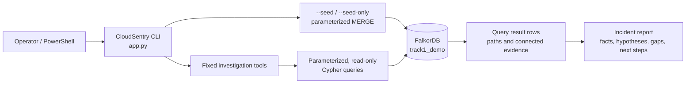
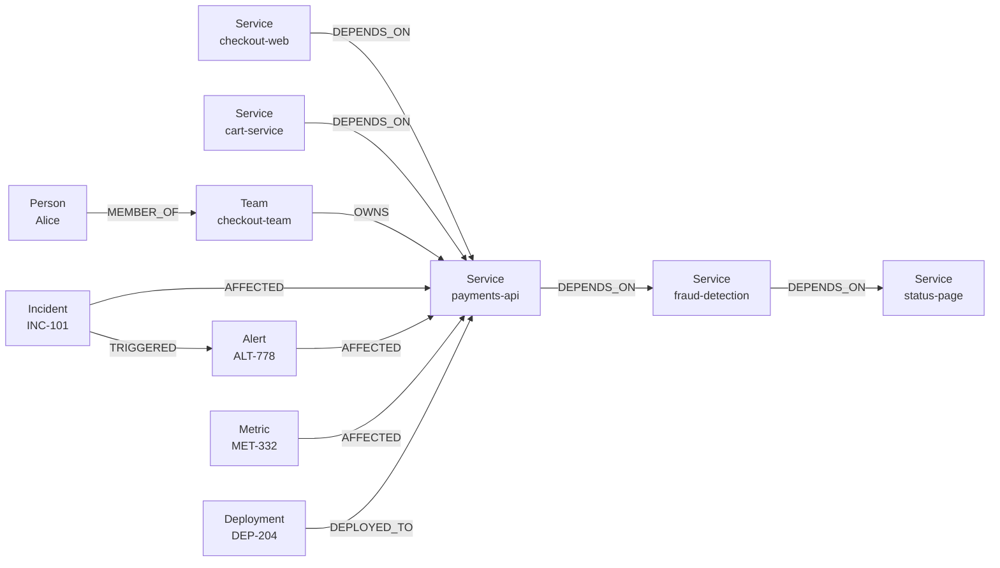

# CloudSentry

CloudSentry is a Python CLI demo that investigates infrastructure incidents using connected service, ownership, deployment, alert, and metric data in FalkorDB. It reports the graph paths and evidence behind its findings; it does not claim that correlation proves cause.

## Problem

During an incident, an operator needs to quickly understand which services depend on the affected service, what that service depends on, who owns it, and what operational signals are recorded nearby. CloudSentry gathers those connected facts from a graph in one repeatable investigation.

## Features

- Read-only, parameterized investigation queries selected from a fixed tool catalogue.
- Blast-radius and dependency paths with hop counts and exact node sequences.
- Owning team, team members, on-call role, deployment, alert, and metric evidence.
- A structured JSON report or a readable terminal report.
- Idempotent synthetic-data seeding using `MERGE`; seeding does not clear the graph.
- No LLM, cloud credentials, remediation actions, or additional runtime service beyond FalkorDB.

## How FalkorDB Drives the Investigation

FalkorDB is the source of the topology and operational context, not just a storage add-on. The CLI validates the service against a `Service` node, then runs five fixed read-only queries. Graph traversals establish the exact dependency paths; relationship matches find team ownership, deployment history, and alerts or metrics attached to the service. Those returned rows become the report's graph facts.

The blast-radius query follows incoming dependency paths:

```cypher
MATCH path = (dependent:Service)-[:DEPENDS_ON*1..4]->(target:Service {name: $service})
RETURN DISTINCT dependent.name, length(path), [n IN nodes(path) | n.name]
```

The query uses a supported fixed maximum of four hops; the CLI validates the requested depth from 1 to 4 and filters results to that depth. Other investigation values, including service names, are passed as query parameters. The ownership, deployment, and alert/metric tools use their explicit graph relationships rather than guessing context from the incident text.

Rows returned from FalkorDB are reported as **confirmed graph facts**: they confirm that the current graph contains those records and relationships. A recent deployment or coincident alert/metric is only a **possible cause**. CloudSentry does not prove causation, and it lists missing evidence when expected records are absent.

## Architecture



## Graph Data Model

The seed data is synthetic. Node identities and selected properties are:

| Node label | Identity | Other seeded properties |
| --- | --- | --- |
| `Service` | `name` | `tier` |
| `Team` | `name` | None |
| `Person` | `name` | `email`, `on_call` |
| `Incident` | `id` | `summary`, `at` |
| `Deployment` | `id` | `version`, `at`, `summary` |
| `Alert` | `id` | `at`, `summary`, `signal`, `value` |
| `Metric` | `id` | `at`, `summary`, `signal`, `value` |

Relationships are directed as shown below. The relationship direction matters: `checkout-web` depends on `payments-api`, while blast radius starts at services that point toward the affected service.



`blast_radius` traverses `dependent -[:DEPENDS_ON*]-> affected_service`. `dependencies` traverses in the opposite direction from the target service to its dependencies. `ownership` follows `Team -[:OWNS]-> Service` and `Person -[:MEMBER_OF]-> Team`. `recent_changes` follows `Deployment -[:DEPLOYED_TO]-> Service`. `related_alerts` matches `Alert` or `Metric` nodes with `-[:AFFECTED]-> Service`.

The `Incident -[:AFFECTED]-> Service` and `Incident -[:TRIGGERED]-> Alert` relationships are included in the seeded graph. The current investigation tools query alerts and metrics by affected service; they do not yet use the incident ID to filter those events.

## Setup (Windows)

Prerequisites: Python (the project was exercised with Python 3.12.1), Docker Desktop, and a FalkorDB server reachable at `localhost:6379`. This project does not include Docker Compose or a container configuration. If no FalkorDB container is already running, one way to start the official image is:

```powershell
docker run -d --name cloudsentry-falkordb -p 6379:6379 falkordb/falkordb:latest
Test-NetConnection localhost -Port 6379
```

If a container is already bound to port 6379, use it rather than starting another one. The Python client used by the project is `falkordb`:

```powershell
py -m pip install falkordb
```

The CLI defaults to host `localhost`, port `6379`, and graph `track1_demo`. These can be overridden in PowerShell:

```powershell
$env:FALKORDB_HOST = "localhost"
$env:FALKORDB_PORT = "6379"
$env:FALKORDB_GRAPH = "track1_demo"
```

## Seed, Test, and Investigate

From the project directory:

```powershell
# Merge the synthetic dataset; safe to repeat and does not delete graph data.
py .\app.py --seed-only

# Run the offline unit tests and the live integration test.
py -m unittest -v

# Seed, then investigate payments-api with a three-hop blast-radius limit.
py .\app.py --seed --service payments-api --depth 3 --incident "Service payments-api is returning HTTP 500 errors. Investigate the impact and identify the likely cause and responsible team."

# Optional structured JSON output.
py .\app.py --service payments-api --depth 3 --json
```

The test suite uses the built-in `unittest` framework. Its integration test connects to FalkorDB, checks report evidence, verifies that repeat seeding does not change seeded counts, and confirms an unrelated test node survives seeding. No `pytest` dependency is required.

## Example Report

Excerpt captured from a local run of the command above against the seeded graph:

```text
CONFIRMED GRAPH FACTS
Blast radius (dependent -> ... -> affected service):
  cart-service (1 hop(s)): cart-service -> payments-api
  checkout-web (1 hop(s)): checkout-web -> payments-api
Dependencies (service -> ... -> dependency):
  fraud-detection (1 hop(s)): payments-api -> fraud-detection
  status-page (2 hop(s)): payments-api -> fraud-detection -> status-page
Ownership:
  checkout-team: Alice; on-call: primary
Recent deployments:
  DEP-204 payments-api 2.8.1 at 2026-10-18T09:42:00Z: Payments API release 2.8.1
Related alerts and metrics:
  MET-332 (Metric) at 2026-10-18T09:59:00Z: Payments API p95 latency elevated [http_p95_latency_ms=1850]
  ALT-778 (Alert) at 2026-10-18T09:58:00Z: Elevated HTTP 5xx rate [http_5xx_rate=12%]

POSSIBLE CAUSES (not proven)
  A recent deployment may be related to the incident; this is not proven.
  Alert or metric signals correlate with the incident but do not prove its cause.
```

For example, the `checkout-web -> payments-api` path is a graph-backed dependency fact. The nearby deployment is evidence present in the graph, but its causal connection to the errors remains unproven.

## Limitations and Next Steps

- All seeded records and signal values are synthetic, not live telemetry.
- The app runs one CLI investigation; it has no persistent server, UI, or LLM.
- Relationship and event coverage is limited to the seeded graph. The current alert lookup is service-based, not incident-ID-based.
- The report cannot establish causation. It recommends checking the deployment/error timeline, logs, traces, and the owning team's assessment.
- Useful follow-up work would be expanding the graph with real-but-safe demo fixtures, querying alerts by incident identity, and adding tests for more graph shapes.